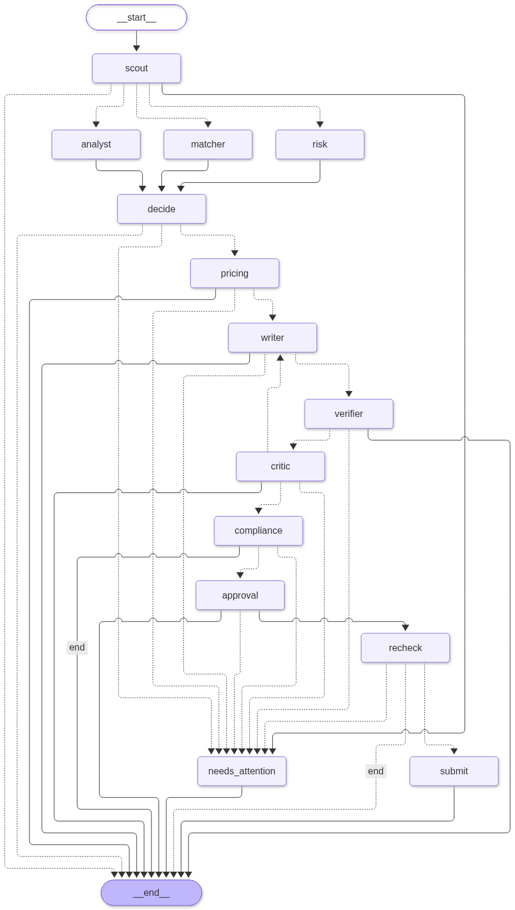

# GigBid

Agents that find freelance jobs, assess them, draft proposals grounded in portfolio evidence and manage client
chats. A human approves every proposal, message and Connects spend. It runs against GigSim, our own synthetic
marketplace simulator, and has an adapter for the official Upwork MCP behind the same port.

AI-4016 Assignment II. Everything here is synthetic data. Every number below is generated from
`evals/results/*.json` by `scripts/render_tables.py` (see `docs/results_tables.md`).

- Live URL: **not deployed yet, see Honest limitations** (reviewer login is in the private Classroom comment, not in this repo)
- Demo video: not added yet
- Public traces (LangSmith): [docs/TRACES.md](docs/TRACES.md)
- Report: `docs/report/REPORT.pdf`. Architecture: [docs/ARCHITECTURE.md](docs/ARCHITECTURE.md)

## What it is



Two durable LangGraph graphs (bid, conversation), nine agents, three of our own MCP servers (Marketplace,
Portfolio, Workspace), a typed FastAPI backend, a Next.js UI with all screens, an Arq worker on Redis, Postgres
checkpoints and LangSmith traces. Nothing is sent before the user approves it in the web UI (`interrupt()`), and a
pending approval survives an API restart. Why each agent exists is in `docs/ARCHITECTURE.md`.

## Quickstart

```
uv sync            # or: python -m venv .venv && pip install -e .
make seed          # generate the synthetic GigSim data
make dev           # GigSim on 9000 and the API
make test          # unit, integration and contract tests
docker compose -f infra/docker-compose.yml up        # everything, with Ollama
docker build -f infra/docker/all-in-one.Dockerfile -t gigbid-all .   # single image used for hosting
```

Model profiles are in `agent/config.yaml` and `agent/config_extra.yaml`: `open` is local Ollama, `open_hosted` is
Groq with an open weight model. Select with `GIGBID_PROFILE`. Copy `.env.example` to `.env` for secrets.
Pinned versions: Python packages with `==` in `pyproject.toml`, Node packages in `apps/web/package-lock.json`,
local models `qwen2.5:7b-instruct`, `llama3.2:3b` and `llama3.1:8b` (Ollama tags), hosted `qwen/qwen3.8-27b`.

## Results

### Retrieval and proposal quality (B5)

**Main results table (B5)**

| Variant | Evidence Recall@5 | nDCG@10 | Unsupported claims per proposal (after verifier) | Judge score (uncalibrated) | GigSim reply rate | p95 latency s | Cost per proposal USD |
|---|---|---|---|---|---|---|---|
| v0_naive | 0.359 | 0.906 | 0.000 | 3.56 | 0.39 | 32.8 | 0.00007 |
| v3_rerank | 0.385 | 0.943 | 0.000 | 3.59 | 0.24 | 32.9 | 0.00009 |

Proposal columns: n = 18 per variant, model groq/qwen/qwen3.8-27b, profile open_hosted. Source: evals/results/rag_eval.json and evals/results/proposal_eval.json.

**Retrieval variants**

| Variant | Recall@5 | Recall@5 capped | MRR | nDCG@10 | Recall@5 (4+ requirements) | p95 ms |
|---|---|---|---|---|---|---|
| v0_naive | 0.359 | 0.896 | 0.972 | 0.906 | 0.344 | 105.8 |
| v0b_tfidf | 0.372 | 0.914 | 0.960 | 0.931 | 0.353 | 3.2 |
| v1_decompose | 0.376 | 0.936 | 0.996 | 0.929 | 0.351 | 32.4 |
| v2_hybrid | 0.367 | 0.906 | 0.972 | 0.923 | 0.349 | 87.2 |
| v1_decompose_hybrid | 0.367 | 0.914 | 0.983 | 0.925 | 0.343 | 54.1 |
| v3_rerank | 0.385 | 0.947 | 0.996 | 0.943 | 0.349 | 6994.0 |
| v8_corrective | 0.347 | 0.876 | 0.937 | 0.880 | 0.328 | 12738.7 |

n jobs = 121. Source: evals/results/rag_eval.json.

The hypothesis written before the runs (V1+V2+V3 gain 10 points Recall@5 on jobs with 4+ requirements) was
**rejected**. See `docs/adr/0002-rag-hypothesis.md` and `docs/adr/0003-rag-shipped-choice.md`.

**Ablation, one component removed**

| Pipeline | Recall@5 | MRR | nDCG@10 | Recall@5 4+ |
|---|---|---|---|---|
| full | 0.385 | 0.996 | 0.943 | 0.349 |
| no_decompose | 0.377 | 0.974 | 0.939 | 0.355 |
| no_bm25 | 0.385 | 0.996 | 0.943 | 0.349 |
| no_dense | 0.385 | 0.996 | 0.943 | 0.349 |
| no_rerank | 0.367 | 0.983 | 0.925 | 0.343 |
| no_marker | 0.355 | 0.949 | 0.884 | 0.336 |

Best pipeline v3_rerank, n = 121. Source: evals/results/ablation.json.


### Multi-agent comparison (R&D question C)

**R&D C: architecture comparison**

| Architecture | Bid-or-skip acc | Bid F1 | Unsupported per letter | Violating letters shipped | Expected reply prob | Tokens per job | p50 latency s |
|---|---|---|---|---|---|---|---|
| react | 0.233 | 0.34 | 0.64 | 0 | 0.220 | 23508 | 18.5 |
| supervisor | 0.6 | 0.33 | 0.88 | 0 | 0.223 | 13113 | 53.8 |
| graph | 0.667 | 0.67 | 0.00 | 0 | 0.274 | 1990 | 36.6 |

Source: evals/results/arch_compare.json. meta: {"model": "qwen2.5:7b-instruct", "n_jobs_completed": 30}

Same model (local qwen2.5:7b-instruct), same 30 dev jobs per architecture. The hand built graph won on bid or skip
accuracy, unsupported claims and tokens. The ReAct agent was the fastest per job and the supervisor the slowest.

### Tool design (R&D question A)

**R&D A: tool design**

| Tool set | Tools | Selection accuracy | Argument accuracy | Tokens per task |
|---|---|---|---|---|
| fine | 9 | 0.950 | 0.825 | 1008 |
| coarse | 3 | 0.675 | 0.575 | 710 |
| best | 9 | 0.975 | 0.900 | 1630 |

Model qwen2.5:7b-instruct, n = 40 tasks. Source: evals/results/tool_design.json.


### Prompt injection

**Prompt injection attack success rate**

| Defences | n | Attack successes | ASR | 95% CI | Writer followed instruction |
|---|---|---|---|---|---|
| off | 20 | 4 | 0.20 | 0.08 to 0.42 | 11 |
| on | 20 | 3 | 0.15 | 0.05 to 0.36 | 8 |

Writer model groq/qwen/qwen3.8-27b. Source: evals/results/injection_eval.json.

The defences did not produce a statistically clear improvement at this sample size.

### Declared budgets

**Declared budgets against measured**

| Unit | Declared p95 / cost | Measured p95 | Measured cost (mean) | Sample | Within |
|---|---|---|---|---|---|
| job analysed | 20 s / 0.0005 USD | 3.2 s | 0.00006 USD | n = 16 | yes |
| proposal drafted | 60 s / 0.002 USD | 32.8 s | 0.00007 USD | n = 18 (v0_naive) | yes |

Profile open_hosted (Groq, free tier pacing included in latency). Dev set, not the hidden test. Source: evals/results/budget_eval.json and proposal_eval.json.


### Extension X2 and change request

**Extension X2: proposal strategy A/B**

| Strategy | n | Replies | Reply rate |
|---|---|---|---|
| A | 19 | 5 | 0.263 |
| B | 20 | 3 | 0.150 |

Two proportion test: {"rate_A": 0.2631578947368421, "rate_B": 0.15, "diff_B_minus_A": -0.1131578947368421, "ci95_diff": [-0.36553839144532785, 0.13922260197164363], "z": -0.874748326648604, "p_value_two_sided": 0.3817108587689375, "fisher_exact_p": 0.4505764505764504, "significant_at_0.05": false, "min_detectable_diff_80pct_power": 0.3620903551747944}
Source: evals/results/x2_experiment.json.

**Change request**

| Measure | Value |
|---|---|
| elapsed minutes (tag to tag) | 3.7 |
| files changed | 6 |
| config_or_docs lines | +9 / -5 in 2 file(s) |
| code lines | +26 / -0 in 1 file(s) |
| tests lines | +64 / -0 in 1 file(s) |

| Persona | Bid F1 before | Bid F1 after | Bid precision before | Bid precision after |
|---|---|---|---|---|
| ai_ml | 0.75 | 0.89 | 0.60 | 0.79 |
| web | 0.75 | 0.81 | 0.60 | 0.68 |
| data | 0.77 | 0.94 | 0.62 | 0.88 |

Caveat: the metrics rise because every one of the 30 synthetic lowball jobs has a budget of exactly 40 USD, just under the self chosen 50 USD minimum, so the new rule removes them by construction. It is not evidence of better judgement. No node code changed; the only Python added is the test fixture conftest.py. self imposed change request, mirrors the announced 2 Nov platform policy update format; the instructor did not publish a concrete policy text for self built simulators. Source: evals/results/change_request.json.


### Two open model configurations

**Two LLM configurations**

| Config | Writer model | n | Judge | Unsupported | p50 latency s | tokens/s | USD per proposal |
|---|---|---|---|---|---|---|---|
| local_open | ollama/qwen2.5:7b-instruct | 9 | 3.44 | 0.00 | 103.1 | 38.3 | 0.00000 |
| hosted_open | groq/qwen/qwen3.8-27b | 9 | 3.44 | 0.00 | 30.8 | n/a | 0.00009 |

Source: evals/results/model_compare.json.


## Honest limitations

- All data is synthetic and generated by `gigsim/generate.py`. The Kaggle datasets the instructor allowed were not
  used (no API token was set up). Scam and retrieval gold labels are partly circular, see `docs/DATA_CARD.md`.
- Sample sizes are small (17 to 40 per arm) because of the Groq free tier, so most intervals are wide.
- The LLM judge is not calibrated until Cohen's kappa against human labels exists (`evals/results/judge_calibration.json`).
- The live Upwork adapter is a documented stub and was never run against a real account. The GitHub MCP server is
  configured and documented, not exercised in the evaluated paths.
- Incremental re-indexing of the portfolio is not implemented. Per agent tool allowlists are enforced inside the
  graph (`tests/integration/test_graph_allowlists.py`), and the Compliance Guard has no marketplace access.
- The pipeline board fills drafted, submitted, replied, interview (derived from client messages) and lost. GigSim
  has no events for viewed or hired, so those two columns stay empty.
- The Critic rejects every draft, so every proposal uses both send backs (extra latency).
- Public hosting: see the live URL line above for its current status.

## Repository map

`agent/` graphs, nodes, prompts, memory. `rag/` ingestion, variants, verifier. `mcp_servers/` Marketplace,
Portfolio, Workspace. `apps/api` FastAPI, `apps/web` Next.js. `worker/` Arq. `gigsim/` the simulator.
`evals/` runners and committed results. `docs/` architecture, ADRs, data card, tools, runbook, traces, report.
The Portfolio MCP server has its own README in `mcp_servers/portfolio/README.md`.

## Resume bullet

Built GigBid, a nine agent LangGraph system with human approval, three MCP servers and a Next.js UI; a claim verifier cut unsupported claims from 0.59 to 0.00 per proposal, and the hand built graph beat a ReAct agent on bid or skip accuracy (0.67 against 0.23) at 1990 against 23508 tokens per job (30 synthetic dev jobs).
