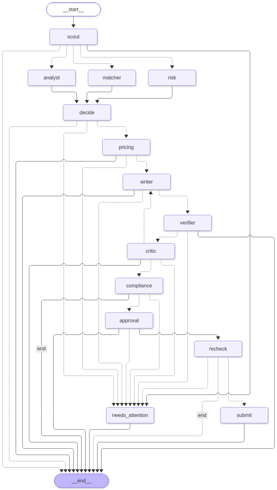
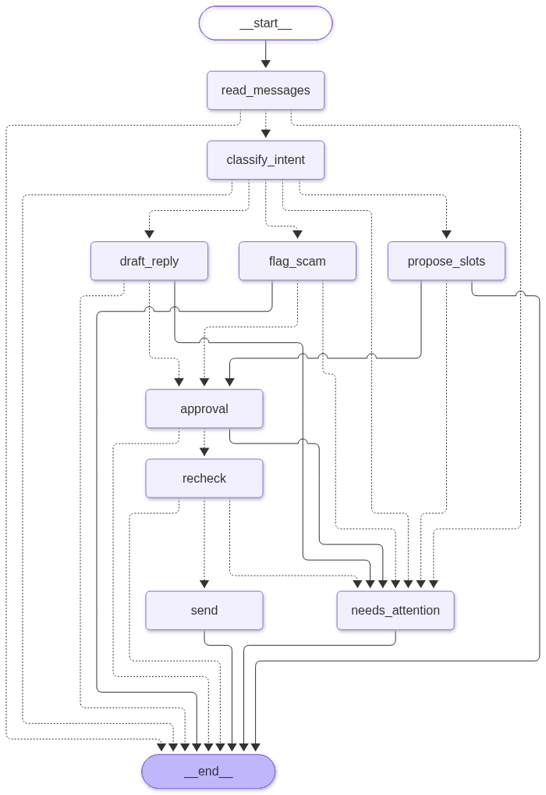

# Architecture

GigBid finds freelance jobs, assesses them, drafts proposals grounded in portfolio evidence and manages
client chats. A human approves every proposal, message and Connects spend. All numbers cited here live in
`evals/results/`.

## System view

```
Next.js UI --(typed client from openapi.json, SSE)--> FastAPI --> Arq worker (Redis)
                                                         |             |
                                                         v             v
                                       LangGraph bid + conversation graphs (Postgres checkpointer)
                                                         |
                  +--------------------------------------+-----------------------+
                  v                                      v                       v
        Marketplace MCP server                 Portfolio MCP server      Workspace MCP server
        (writes, dry_run, idempotency,         (read only evidence)      (calendar slots, drafts)
         audit log, rate limit)
                  |
        marketplace_port.py  ->  adapters/gigsim.py (default)   adapters/upwork_live.py (optional)
```

One marketplace port with two adapters, chosen by the `MARKETPLACE_MODE` setting (`gigsim` or `upwork`, see `agent/marketplace_port.py`). Switching GigSim to
live changes the adapter and the credentials only. Graph code, prompts and the UI do not change.

## Bid graph (one thread per job)

Rendered from code by `scripts/render_graphs.py`: `docs/images/bid_graph.png` and `bid_graph.mmd`.



Flow: scout hands the job in, then analyst, risk and matcher run in parallel (`Send` fan out), `decide`
joins them into skip, watch or bid. A bid goes through pricing, writer, claim verifier, critic (at most 2
send backs) and compliance, then the `approval` node calls `interrupt()`. Nothing is sent before the
human approves. An edited draft goes to `recheck` (compliance again, edits diffed into style memory)
before `submit`. Budget overrun, repeated failures and compliance blocks end in `needs_attention`.

## Conversation graph (one thread per client conversation)



The liaison reads messages (treated as untrusted data), classifies intent (question, negotiation,
interview request, scam signal), drafts a reply or proposes interview slots from the Workspace server,
and interrupts for approval before any message leaves.

## Why each agent exists

| Agent | Why it is its own node | Tool access |
|---|---|---|
| Scout | Cheap, high volume read of the market. Small model, no reasoning needed. | marketplace read |
| Job Analyst | Turns raw text into a typed `JobSpec`. Sees untrusted text, so has no tools at all. | none |
| Risk Assessor | Scam and policy risk. Independent of fit so one bad score cannot hide the other. | marketplace read |
| Fit Matcher | Requirement to evidence matching through the retriever. | portfolio read |
| Pricing Strategist | Price inside the fair band using client history and Connects cost. | marketplace read |
| Proposal Writer | The only node that writes prose. Strongest affordable model. | portfolio read |
| Claim verifier | Splits the draft into claims and removes unsupported ones before the critic. | none |
| Critic | Reviews quality, sends back at most twice. | portfolio read |
| Compliance Guard | Platform policy and banned phrases, can block with a visible reason. | none |
| Client Liaison | Conversation graph. Intent, replies, interview slots. | marketplace read, write after approval, workspace |

Every prompt is a versioned file in `agent/prompts/`. Thresholds and policy live in `agent/config.yaml`.

## State, trace and memory are kept apart

- State (`agent/state.py`): what this thread needs now. Separate typed fields for job, analyses, evidence,
  decision, price, drafts, critiques, approvals and outcomes. Parallel writes use reducers.
- Execution trace: every tool name, args, result and observation, kept for audit in the MCP audit log and
  LangSmith, never fed back into memory.
- Long-term memory (`agent/memory/`): promoted knowledge only, written by the explicit rules in
  `promotion_rules.py`. Two stores: style memory (from user edits) and outcome memory (what got replies).
  Raw tool output never goes into memory. The Settings screen shows and deletes items.

## Durability

Postgres checkpointer (SQLite in local dev). A run waiting at `approval` survives an API restart and
resumes from the UI. Submit uses an idempotency key so a resume or worker restart cannot send twice
(proved by the restart tests in `tests/integration`). Checkpoint history allows replay from any node.

## Failure handling

Per node timeouts and bounded retries, a fallback model for cheap nodes, a dead letter state, and a
degraded mode: when the Marketplace server is down the API reports `marketplace: down`, the UI shows a
banner, runs queue and drain on recovery.

## Decisions

Short records live in `docs/adr/`.
